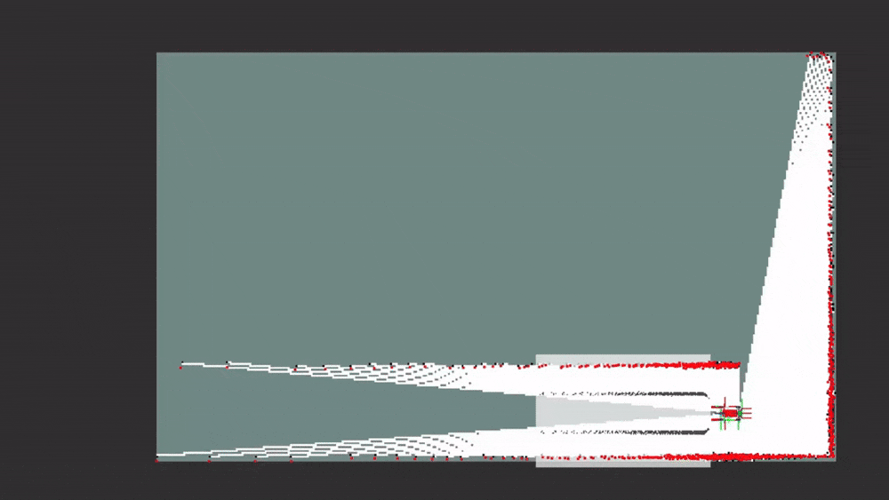

<p align="center">
  <h1 align="center">GLiDAR-SLAM: Ground Constrained 2D LiDAR SLAM</h1>
  <p align="center">
    <strong>Markus Wiechers</strong>
  </p>
</p>
<p align="center">
  <a href="">
    
  </a>
</p>

---

GLiDAR-SLAM is a ground-constrained 2D LiDAR SLAM system implementing a core library and a ROS 2 wrapper.
It combines 2D LiDAR correlative scan matching with optional RGB-D ground-plane, ground-texture, and ground-marking information formulated as a factor-graph SLAM problem.

A demo environment is available at [glidar_slam_demo](https://github.com/markus-wie/glidar_slam_demo).

## Prerequisites

- Ubuntu 26.04 LTS (the packages require CMake 3.27 or newer and a C++17 compiler)
- ROS 2 Lyrical (other distributions are untested)
- Installed dependencies via rosdep (GTSAM, PCL, OpenCV, Eigen, nanoflann, and Intel TBB)

## Build

Build the GLiDAR-SLAM packages in Release mode from your workspace root:

```bash
# Install rosdep dependencies
rosdep update
rosdep install --from-paths src/glidar_slam --ignore-src -r -y
# Build
colcon build --cmake-args -DCMAKE_BUILD_TYPE=Release
```

The unit tests of the core library need no ROS, sensors or recorded data:

```bash
colcon test --packages-select glidar_slam --event-handlers console_direct+
```

## Run

Launch the ROS 2 wrapper with its default configuration:

```bash
source install/setup.bash
ros2 launch glidar_slam_ros glidar_slam.launch.py
```

The launch file accepts `log_level` and `use_sim_time` arguments:

```bash
source install/setup.bash
ros2 launch glidar_slam_ros glidar_slam.launch.py \
  log_level:=info \
  use_sim_time:=true
```

Configuration parameters are located in `glidar_slam_ros/config/glidar_slam_params.yaml`.

The default topics configured are:

| Data | Parameter | Default Topic |
| --- | --- | --- |
| LiDAR Scans | `scan_topic` | `/scan` |
| Odometry (covariance only, see below) | `odom_topic` | `/odom` |
| Color Image (RGB-D) | `color_image_topic` | `/camera/color/image_raw` |
| Aligned Depth Image (RGB-D) | `aligned_depth_image_topic` | `/camera/aligned_depth/image_raw` |
| Camera Calibration (RGB-D) | `color_camera_info_topic` | `/camera/color/camera_info` |

> **Note on Odometry and TF:** The odometry **pose** is not read from `odom_topic`. It is looked up from TF (`odom_frame` to `base_frame` at the scan timestamp, waiting up to `tf_lookup_timeout` seconds). The scan frame (`scan_frame`, or the `frame_id` of the scan message) and, in RGB-D mode, the camera frame must also be available in TF relative to `base_frame`. The `odom_topic` subscription is only used to obtain the odometry covariance. A scan is skipped with a warning if a required transform is unavailable.

> **Note on RGB-D Mode:** Ground plane extraction, ground marking matching, and ground texture mapping require enabling `use_rgbd: true` in the parameter file. The shipped parameter file enables it. When `use_rgbd` is `false`, the node runs in 2D LiDAR-only mode and subscribes directly to `scan_topic`. When `use_rgbd: true`, `message_filters::Synchronizer` synchronizes LiDAR scans with RGB-D camera frames based on `approx_sync_max_interval`.

## Project Structure

The repository contains the following ROS 2 packages:

- **`glidar_slam`**: ROS-independent C++17 SLAM core library. It contains sensor representations, correlative scan matching with likelihood fields, submaps, keyframe management, 6-DoF GTSAM factor graph optimization, custom ground plane factors, background loop closure detection, map building, and binary state serialization.
- **`glidar_slam_ros`**: ROS 2 node wrapper (`Ros2SlamWrapper`). It bridges ROS topics/TF to the core library, exposes dynamic scan-matcher plugins via `pluginlib`, broadcasts the `map -> odom` transform, publishes estimated poses, occupancy/ground maps, debug visualizations, and provides runtime management services.
- **`glidar_slam_msgs`**: ROS 2 service definitions
- **`glidar_slam_eval`**: Evaluation adapter that replays LILocBench rosbags through `glidar_slam_ros`, records the estimated trajectory, and computes APE/RPE metrics against the benchmark ground truth (see [Evaluation](#evaluation-glidar_slam_eval)).

## SLAM Pipeline

1. **Sensor Synchronization and Preprocessing**:
   - In 2D LiDAR-only mode (`use_rgbd: false`), laser scans are received directly.
   - When RGB-D is enabled (`use_rgbd: true`), LiDAR scans, color images, aligned depth images, and camera info are synchronized.
   - Incoming scans can optionally be voxelized (`scan.voxelization_enable`, `scan.voxelization_size`) and densified (`scan.densification_enable`) by linear interpolation along scan rays (spacing `scan.voxelization_size`) to ensure uniform point density. This is an optional preprocessing step to make the point cloud more evenly distributed. Works under certain conditions, but generally does more harm than good (disabled by default).
2. **Motion Estimation**:
   - The odometry pose is looked up from the TF tree (`odom` to `base_link` at scan timestamp); relative displacements are computed against the odometry pose stored with the latest keyframe.
   - Odometry covariance is taken from the diagonal of the odometry message's **twist** covariance if any entry of `odom_covariance_diagonal` is `-1`; otherwise the values of `odom_covariance_diagonal` (`[x, y, z, roll, pitch, yaw]`) are used as an override, which is the default in the shipped parameter file. Non-finite or non-positive twist variances are replaced by `unobservable_variance`.
3. **Keyframe Gating**:
   - A new keyframe is considered when the robot exceeds a translation (`minimum_travel_distance`) or heading (`minimum_travel_heading`) threshold, measured in odometry, relative to the last keyframe.
   - Scans that do not trigger a keyframe are not scan-matched. In mapping mode they only update the odometry-predicted pose and the `map -> odom` transform, and `glidar_slam/estimated_pose` is **not** published for them.
4. **Local Scan Matching**:
   - Keyframe candidates are matched against an active multi-keyframe `SubmapGrid` using a multi-stage `CorrelativeScanMatcher` (CSM) operating on multi-resolution likelihood fields smeared with Gaussian or Laplace kernels (with optional distance transform and Intel TBB parallelization).
   - CSM evaluates a coarse-to-fine search window around the odometry-predicted pose and estimates an optimal planar pose and covariance.
5. **Ground Plane & Ground Marking Constraints (Optional)**:
   - When RGB-D data is available, `GroundPlaneExtractor` extracts ground plane inliers using MSAC (M-estimator SAmple Consensus) within a configurable ROI (`ground_roi_ratios`) and adaptive thresholding for ground markings. The dense ground inliers are then leveled by rotating the observed ground normal onto the base z axis about the camera position, so that dropping z for the 2D ground map and marking matching is not distorted by a tilted ground in the base frame (e.g. from camera extrinsic errors). The plane normal, distance and centroid stay in the unleveled base frame for the ground plane factor. Pixels without a valid depth (NaN, zero, out of range) are ignored. Extraction runs only for keyframe candidates.
   - **Ground Plane Factor**: When `ground_optimization_enable` is true and sufficient inliers exist ($\ge 50$), a custom 3-DOF `GroundPlaneFactor` is added to GTSAM, constraining robot height ($z$) and attitude (roll and pitch) relative to the ground reference plane (map $z = 0$). The initial keyframe receives a ground plane factor as well, and its prior only anchors $x$, $y$ and yaw tightly so that $z$, roll and pitch are not frozen by a single observation. If no usable observation exists for the initial keyframe, it is anchored completely at the identity pose (level, $z = 0$). A warning is logged whenever a keyframe with an observation ends up without a ground plane factor.
   - **Ground Marking Factor**: When `ground_matching_enable` is true, high-contrast ground markings from the camera are matched between consecutive keyframes using `GroundMarkingMatcher` to provide additional relative pose constraints. Matches with a score below `ground_matching_minimum_score` are discarded. Adds significant noise to the trajectory at extra cost (\*holding sarcasm sign\*) 
6. **Keyframe Creation & Submap Management**:
   - Once the keyframe is accepted, it is added to the map database and its scan is inserted into the matching submap.
   - A bounded sliding window of recent keyframes (`submap_window_size`) forms the matching submap.
7. **Factor Graph Optimization**:
   - GTSAM `iSAM2` incrementally optimizes a 6-DoF pose trajectory combining:
     - Prior factor on the initial keyframe (tight in $x$, $y$ and yaw; $z$/roll/pitch are left to the ground plane factor if one is available) or weak prior during tracking reset, see [Services](#services).
     - Consecutive relative scan-matching factors (SE(2) pose with inflated unobservable $z$/roll/pitch covariance), unless the match score is below `tracking_minimum_score`.
     - Between-factors from odometry, which also tie $z$/roll/pitch to the previous keyframe (`relative_height_sigma`, `relative_tilt_sigma`).
     - 3-DoF `GroundPlaneFactor` unary constraints.
     - Optional relative ground-marking factors.
     - Relative loop closure factors.
8. **Loop Closure Detection** (mapping mode only):
   - Every new keyframe is submitted to an asynchronous background thread that searches for loop candidates among older keyframes within a radius of `loop_mahalanobis_threshold` times the largest standard deviation of the query keyframe's XY covariance.
   - Candidates must satisfy minimum key separation (`loop_minimum_key_separation`), a maximum heading difference (`loop_maximum_yaw_difference`), and pass a 2D Mahalanobis distance gate on the global XY position difference. The gate sums the candidate and query XY covariances (rotated into the map frame) and is deliberately permissive since it ignores their correlation. The default `loop_maximum_yaw_difference` of `6.28` effectively disables the heading check. This effectively combines the idea of `proximity` and `loop_closure` links as diffentiated in systems such as RTAB-Map. Necessary workaround to find corrective links when e.g. entering and leaving a room.
   - Only the candidate with the smallest Mahalanobis distance is verified by multi-resolution scan matching against a submap formed by the candidate's neighboring keyframes. When verified (`score >= loop_minimum_score`), a loop closure edge is queued and inserted into the factor graph with the next processed frame, in a graph update of its own.
9. **Multi-Layer Map Construction**:
   - Keyframe scans and ground observations are processed into local occupancy and ground maps.
   - A background thread in `MapBuilder` asynchronously accumulates local maps into global representations:
     - 2D LiDAR Occupancy Grid map (ray-traced via continuous DDA).
     - Ground texture map (RGB colored ground surface).
     - Ground markings grid (occupancy of high-contrast ground markings).
   - When loop closures re-optimize historical keyframe poses, global maps and the local submap are automatically rebuilt.

## Outputs

The ROS wrapper publishes:

- `glidar_slam/estimated_pose` (`geometry_msgs/msg/PoseWithCovarianceStamped`): 6-DoF pose with marginal covariance in the map frame. In mapping mode it is published once per accepted keyframe; in localization mode for every accepted scan.
- `glidar_slam/map` (`nav_msgs/msg/OccupancyGrid`): Global 2D occupancy grid map (published at 1 Hz).
- `glidar_slam/ground_markings_map` (`nav_msgs/msg/OccupancyGrid`): Map of detected ground markings (only if `mapping.ground.enable_ground_marking_mapping` is true).
- `glidar_slam/ground_texture_map` (`sensor_msgs/msg/Image`): High-resolution RGB ground texture image (only if `mapping.ground.enable_texture_mapping` is true).
- `glidar_slam/graph_visualization` (`visualization_msgs/msg/MarkerArray`): Trajectory nodes, neighbor edges, and loop-closure edges for RViz.
- `map -> odom` TF transform: Dynamic transform maintaining consistency between SLAM map and wheel odometry frames (broadcast at 10 Hz, post-dated by 0.6 s).

Optional debug topics (enabled via parameter flags; the ground topics additionally require `use_rgbd: true`):
- `glidar_slam/debug/ground_inliers` (`sensor_msgs/msg/PointCloud2`): Inlier ground plane point cloud (`ground_debug_enable`).
- `glidar_slam/debug/ground_initial_inliers` (`sensor_msgs/msg/PointCloud2`): Voxelized ground cloud used for the initial plane fit (`ground_debug_enable`).
- `glidar_slam/debug/ground_matching` (`sensor_msgs/msg/PointCloud2`): Ground marking alignment cloud (`ground_matching_debug_enable`).
- `glidar_slam/debug/ground_plane` (`visualization_msgs/msg/MarkerArray`): Fitted ground plane normal and boundary markers (`ground_debug_enable`).
- `glidar_slam/debug/ground_overlay` (`sensor_msgs/msg/Image`): Camera view with ground inlier mask overlay (`ground_debug_enable`).
- `glidar_slam/debug/ground_extraction` (`sensor_msgs/msg/Image`): Adaptive thresholding debug visualization.
- `glidar_slam/debug/csm_likelihood_low` & `glidar_slam/debug/csm_likelihood_high` (`sensor_msgs/msg/Image`): Multi-resolution likelihood field images (plugin parameter `csm_debug_enable`).

## Modes

GLiDAR-SLAM provides two operational modes:

- **Mapping Mode (`startup.mode: "mapping"`)**: Continuously creates new keyframes, adds constraints to iSAM2, accumulates maps, and detects loop closures.
- **Localization Mode (`startup.mode: "localization"`)**: Operates against a pre-loaded map (loaded at startup from `startup.map_load_path` or toggled at runtime).
  - Keyframe generation, graph optimization, and loop closure are disabled.
  - The robot pose is estimated by matching incoming scans against a submap constructed from the keyframes within a 2 m radius of the current pose (`map_database_->getNearbyKeyFrames()`).
  - Scan matching measurements update an internal 2D Extended Kalman Filter (`Pose2EKF`) integrating odometry predictions with scan matcher corrections.
  - If the best match score falls below `localization_minimum_score`, the scan is rejected ("Localization lost"): no pose is published and `map -> odom` keeps its last value until a scan matches again.
  - As the robot traverses past `minimum_travel_distance`, the local submap dynamically shifts to recenter around the new position.
  - Global relocalization is not implemented: an initial pose estimate is required when starting or entering localization mode.

## Services

The node exposes services under the `glidar_slam/` namespace:

- `glidar_slam/save_state` (`glidar_slam_msgs/srv/SaveSlamState`): Serializes keyframes, factors, and graph structure to a binary file.
- `glidar_slam/load_state` (`glidar_slam_msgs/srv/LoadSlamState`): Loads a saved state, rebuilds maps, and resumes in either mapping or localization mode.
- `glidar_slam/save_maps` (`glidar_slam_msgs/srv/SaveMaps`): Exports the occupancy grid (`.pgm` + `.yaml`) and ground texture (`.png` + `.yaml`).
- `glidar_slam/save_trajectory` (`glidar_slam_msgs/srv/SaveTrajectory`): Writes the globally optimized keyframe poses, including all loop closure corrections, to a TUM file.
- `glidar_slam/set_localization_mode` (`glidar_slam_msgs/srv/SetLocalizationMode`): Dynamically switches between mapping and localization modes.

### Save SLAM State

```bash
ros2 service call /glidar_slam/save_state \
  glidar_slam_msgs/srv/SaveSlamState \
  "{path: '/tmp/glidar_mapping.bin'}"
```

### Load SLAM State

Load state and continue in mapping mode using the saved pose:

```bash
ros2 service call /glidar_slam/load_state \
  glidar_slam_msgs/srv/LoadSlamState \
  "{ \
    path: '/tmp/glidar_mapping.bin', \
    mode: 'mapping', \
    use_saved_pose: true, \
    initial_map_pose: \
    { \
      position: {x: 0.0, y: 0.0, z: 0.0}, \
      orientation: {x: 0.0, y: 0.0, z: 0.0, w: 1.0} \
    } \
  }"
```

To load directly into localization mode, set `mode: 'localization'`. If `use_saved_pose` is `false`, `initial_map_pose` provides the starting pose. In mapping mode, `use_saved_pose: false` triggers a tracking reset: a new keyframe with a weak prior is created at `initial_map_pose` and tied back to the loaded graph by loop closure.

### Save Maps

Exports `<base_filepath>.pgm` / `<base_filepath>.yaml` (standard map_server format; unknown cells are written as 205) and/or `<base_filepath>_texture.png` / `<base_filepath>_texture.yaml`. The request fails without writing anything if a requested map is not available, i.e. it is still empty, disabled or larger than 20000 cells per side:

```bash
ros2 service call /glidar_slam/save_maps \
  glidar_slam_msgs/srv/SaveMaps \
  "{ \
    base_filepath: '/tmp/glidar_map', \
    save_occupancy: true, \
    save_texture: true \
  }"
```

### Set Localization Mode

Switch an active mapping session into localization mode using the current estimated pose:

```bash
ros2 service call /glidar_slam/set_localization_mode \
  glidar_slam_msgs/srv/SetLocalizationMode \
  "{ \
    enable: true, \
    use_current_pose: true, \
    initial_map_pose: { \
      position: {x: 0.0, y: 0.0, z: 0.0}, \
      orientation: {x: 0.0, y: 0.0, z: 0.0, w: 1.0} \
    } \
  }"
```

To exit localization mode and resume mapping (the current pose is always used; `use_current_pose` and `initial_map_pose` are ignored when disabling, and a tracking reset is performed):

```bash
ros2 service call /glidar_slam/set_localization_mode \
  glidar_slam_msgs/srv/SetLocalizationMode \
  "{ \
    enable: false, \
    use_current_pose: true, \
    initial_map_pose: { \
      position: {x: 0.0, y: 0.0, z: 0.0}, \
      orientation: {x: 0.0, y: 0.0, z: 0.0, w: 1.0} \
    } \
  }"
```

## Configuration

All parameters are configured in `glidar_slam_ros/config/glidar_slam_params.yaml`:

- **Coordinate Frames**: `odom_frame`, `map_frame`, `scan_frame`, `camera_frame`, `base_frame`.
- **Topics & Sync**: `scan_topic`, `odom_topic`, camera topics, `use_rgbd`, `approx_sync_max_interval`, `tf_lookup_timeout` (seconds to wait for TF lookups, default 0.1).
- **Motion & Keyframes**: `minimum_travel_distance`, `minimum_travel_heading`, `submap_window_size`, `unobservable_variance`, `relative_tilt_sigma` and `relative_height_sigma` (sigmas of roll/pitch and z between consecutive keyframes), `odom_covariance_diagonal` (`[x, y, z, roll, pitch, yaw]`, use `-1.0` for an entry to take the covariance from the odometry message instead).
- **Startup**: `startup.mode` (`"mapping"` or `"localization"`), `startup.map_load_path`, `startup.initial_pose`.
- **Tracking**: `tracking_minimum_score` (scan matches below this score add no scan-matching factor, the keyframe is then constrained by odometry, the ground plane and, if enabled, ground marking matching).
- **Localization**: `localization_minimum_score` (minimum CSM score for accepting a pose).
- **LiDAR Preprocessing**: `scan.voxelization_enable`, `scan.voxelization_size`, `scan.densification_enable`.
- **Mapping**: `mapping.occupancy.resolution`, `mapping.occupancy.threshold` (occupancy probability above which a cell is treated as occupied, default 0.5), `mapping.ground.resolution`, `mapping.ground.enable_texture_mapping`, `mapping.ground.enable_ground_marking_mapping`, update probabilities (`prob_hit`, `prob_miss`, `prob_cap_min`, `prob_cap_max`).
- **Ground Processing**: `ground_optimization_enable`, `ground_normal_sigma`, `ground_distance_sigma`, `ground_roi_ratios`, `ground_extraction_pixel_stride`, `ground_extraction_distance_threshold`, `ground_extraction_voxel_size`, `ground_extraction_max_distance`, `ground_extraction_adaptive_threshold_block_size`, `ground_extraction_adaptive_threshold_C`.
- **Ground Marking Matching**: `ground_matching_enable`, `ground_matching_minimum_score`, `ground_matching_max_distance`.
- **Loop Closure**: `loop_minimum_key_separation`, `loop_maximum_yaw_difference`, `loop_mahalanobis_threshold`, `loop_minimum_score`.
- **Debugging**: `debug_visualize_covariances`, `debug_timings`, `ground_debug_enable`, `ground_matching_debug_enable`, `loop_debug_enable`.
- **Plugin Configurations**: Plugin declarations for `csm_local_tracker`, `csm_ground_marking_detection`, and `csm_loop_closure_detection` configuring multi-stage likelihood search parameters (`csm_stage_resolutions`, `csm_stage_translation_steps`, `csm_stage_angular_steps`, search windows, kernel type, and TBB parallelization).
- **Backend Optimization**: `isam_relinearizeThreshold`, `isam_relinearizeSkip`.

## Evaluation (`glidar_slam_eval`)

`glidar_slam_eval` validates the SLAM system against the [LILocBench](https://github.com/PRBonn/LILocBench) benchmark ([project page](https://www.ipb.uni-bonn.de/html/projects/localization_benchmark)), a long-term indoor localization benchmark recorded on a Clearpath Dingo robot (two 2D LiDARs, RealSense cameras, wheel odometry) with AprilTag-based ground truth. It replays a benchmark rosbag through GLiDAR-SLAM, records the estimated trajectory and compares it to the ground truth.

### Components

- `lidar_fusion` (C++ node): Approximate-time-synchronizes the front and rear `LaserScan` topics, transforms the rear scan into the front scan frame via TF, and merges both into a single `LaserScan`. Parameters: `front_scan_topic`, `rear_scan_topic`, `output_topic`, `sync_queue_size`, `sync_max_interval`, `tf_lookup_timeout`.
- `scripts/rgbd_bridge_node.py` (`rgbd_bridge`): For every fused scan it publishes a synthetic RGB-D triple (constant ground-plane depth image, patterned color image, `CameraInfo`) in `camera_front_color_optical_frame` at the scan timestamp, and writes `glidar_slam/estimated_pose` to a TUM trajectory file.
- `scripts/sim_pose_recorder.py` (`sim_pose_recorder`): Simulation evaluation. Records the Gazebo ground truth as a TUM file and exports the final SLAM trajectory and occupancy map through the `glidar_slam` services, see [Simulation Evaluation](#simulation-evaluation).
- `scripts/evaluate_trajectory.py`: Computes the metrics and writes `metrics.json` and `summary.txt`.
- `scripts/plot_trajectory.py`: Plots estimated versus ground-truth XY trajectory.
- `launch/eval.launch.py`: Runs the complete pipeline. `launch/gdb_slam.launch.py` starts only the SLAM node inside `xterm -e gdb` for debugging; it expects the bag playback and `lidar_fusion` to run separately (defaults `/scan` and `/dingo_velocity_controller/odom`, same as `eval.launch.py`).

### Build

```bash
colcon build --packages-up-to glidar_slam_eval --cmake-args -DCMAKE_BUILD_TYPE=Release
```

The plotting script requires `python3-matplotlib` and `python3-numpy` (declared in `package.xml`).

### Run

```bash
ros2 launch glidar_slam_eval eval.launch.py \
  bag_path:=/path/to/lilocbench_rosbag \
  ground_truth_path:=/path/to/gt_poses.txt
```

The launch file starts `lidar_fusion`, `glidar_slam` (parameters from `glidar_slam_ros/config/glidar_slam_params.yaml`, `use_sim_time` enabled) and `rgbd_bridge`, then plays the bag with `ros2 bag play --clock`. When playback finishes it waits 1.5 s, calls `glidar_slam/save_maps` (occupancy map only), runs the trajectory evaluation and the plot, and shuts everything down.

| Argument | Default |
|---|---|
| `bag_path` | Set this to the benchmark rosbag |
| `ground_truth_path` | Set this to the ground truth (TUM format) |
| `output_dir` | Timestamped run directory |
| `trajectory_path` | `<run dir>/estimated.tum` |
| `map_base_path` | `<run dir>/occupancy_map` |
| `scan_topic` | `/scan` (fused scan) |
| `front_scan_topic` / `rear_scan_topic` | `/laser_scan_front/scan` / `/laser_scan_rear/scan` |
| `odom_topic` | `/dingo_velocity_controller/odom` |
| `playback_rate` | `1.0` |
| `alignment_mode` | `se2` (`none` or `se2`) |

> **Note:** The default run directory is created when the launch file is evaluated. When overriding `output_dir`, also pass `trajectory_path` and `map_base_path`, otherwise they still point to the default run directory.

> **Note on RGB-D:** `eval.launch.py` sets `use_rgbd` to `false`, so the synthetic RGB-D data is not consumed and the evaluation runs LiDAR plus odometry only. Change that override to use it.

> **Note on the trajectory:** The recorded trajectory is the online estimate at keyframe rate. It is not rewritten after loop closures, so it does not contain later graph-optimization corrections.

The evaluation can also be run on existing files:

```bash
python3 glidar_slam_eval/scripts/evaluate_trajectory.py \
  --ground-truth gt_poses.txt --estimate estimated.tum --output-dir out \
  --alignment-mode se2 --rpe-time-step 1.0 --rpe-distance-step 1.0
python3 glidar_slam_eval/scripts/plot_trajectory.py estimated.tum gt_poses.txt --output out/trajectory_comparison.png
```

### Simulation Evaluation

`launch/sim_eval.launch.py` performs the same evaluation in Gazebo instead of on a benchmark bag. It includes a simulation launch file that starts Gazebo, the robot and `glidar_slam`, and records the ground truth from the transforms of the simulated robot. These are expected as `tf2_msgs/TFMessage` on `ground_truth_topic`, for example from the `gz::sim::systems::PosePublisher` plugin bridged to ROS. `ground_truth_static_topic` is only needed for a `ground_truth_frame` that is connected through static transforms.

```bash
ros2 launch glidar_slam_eval sim_eval.launch.py duration:=80
```

`sim_pose_recorder` chains the Gazebo transforms from the world down to `ground_truth_frame`, which has to coincide with the frame `glidar_slam` estimates (`base_frame`), and writes `ground_truth.tum` at the rate of the dynamic pose updates. It stops `duration` simulation seconds after the first pose on `/glidar_slam/estimated_pose` and then saves the occupancy map and the final optimized keyframe trajectory (`estimated.tum`) through the `glidar_slam/save_maps` and `glidar_slam/save_trajectory` services. The launch file then runs `evaluate_trajectory.py` and `plot_trajectory.py` with the same metrics as the benchmark evaluation, and shuts down. The SLAM map origin is the first keyframe, so `se2` alignment (default) is needed to compare it with the world-frame ground truth.

| Argument | Default |
|---|---|
| `output_dir` | Timestamped `sim_*` run directory |
| `duration` | `60.0` simulation seconds (`0` records until the launch is interrupted, then no metrics are computed) |
| `ground_truth_topic` / `ground_truth_static_topic` | `/gz/tf` / `/gz/tf_static` |
| `ground_truth_frame` | Model frame of the simulated robot |
| `estimated_pose_topic` | `/glidar_slam/estimated_pose` |
| `alignment_mode` | `se2` |

A recorded run can be re-evaluated with the commands above using `ground_truth.tum` and `estimated.tum`.

### Metrics and Outputs

Estimated poses within the time range of the ground truth are compared against the (linearly/slerp interpolated) ground truth at the estimated timestamps. With `se2` alignment a closed-form 2D rigid alignment is applied first, which keeps the roll and pitch of the estimate. The metrics are planar (XY and yaw), except for the 3D APE:

- APE translation [cm] and rotation [deg], planar and in 3D (RMSE and maximum).
- Fraction of poses with planar translation error below 5 cm / 10 cm and yaw error below 1° / 2° / 4°.
- RPE translation and rotation in the local frame over a time step (default 1 s) and a distance step (default 1 m). Pairs that span a gap in the data are skipped.

Results are written to `output_dir`: `estimated.tum`, `occupancy_map.pgm/.yaml`, `metrics.json`, `summary.txt` and the trajectory plot. If fewer than two estimated or overlapping ground-truth poses exist, `metrics.json` reports `status: insufficient_data`.

## Scope and Limitations

- **Planar LiDAR Trajectory with 3D Ground Constraints**: Primary motion estimation is planar (SE(2)), but the factor graph optimizes a 6-DoF trajectory where $z$, roll, and pitch are constrained by ground plane factors and unobservable directions are regularized by covariance inflation.
- **RGB-D Ground Processing Only**: RGB-D camera data is utilized strictly for ground plane estimation, ground marking alignment, and planar texture mapping; it does not provide a general 3D reconstruction pipeline.
- **Relocalization**: Global relocalization is not supported; switching to or starting in localization mode requires an accurate initial pose estimate. Loosing track of the correct pose will prevent recovery without manual intervention. This is an important todo for the future.
- **Binary State Format**: State serialization uses an internal binary stream representation tailored for the system's data structures; binary compatibility is not guaranteed across breaking data structure revisions.
